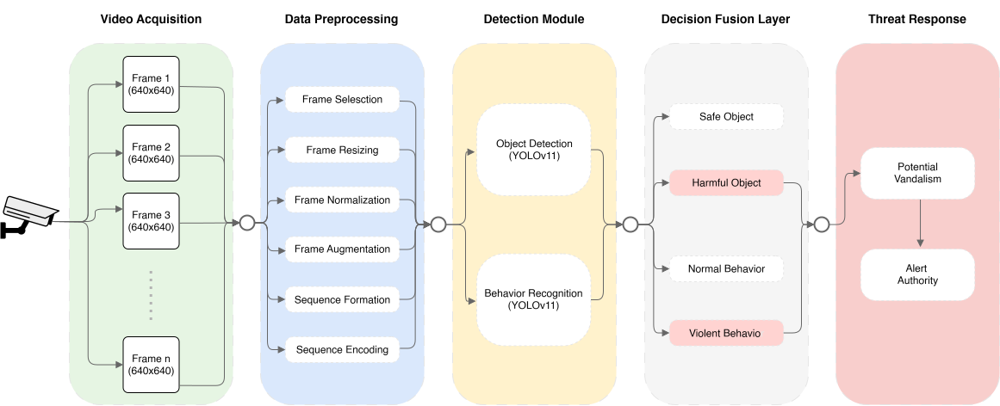

# Campus Surveillance with Harmful-Object and Aggressive-Actor Detection

Code, model records, dataset provenance, and numerical analysis resources for a frame-based campus surveillance implementation using YOLO11 object and aggressive-actor detectors.



*Proposed system architecture. The figure describes the conceptual workflow; the executable scope is defined by the original application and its run documentation.*

## Implementation

The original application processes video frames at 640 × 640 resolution, runs the object and aggressive-actor detectors sequentially, and maps their outputs to four displayed cue states. It writes an annotated video and decision logs, with frame-image output when an aggressive-actor cue is present. The implementation is frame-based; it does not construct temporal sequences.

The architecture figure includes conceptual processing and response stages beyond the retained application. The executable implementation is documented in [implementation/README.md](implementation/README.md).

## Repository structure

| Path | Contents |
|---|---|
| [implementation/](implementation/) | Original integrated application and execution instructions |
| [training/](training/) | Original Ultralytics CLI commands, saved arguments, training histories, and source screenshots |
| [datasets/](datasets/) | Dataset versions, split counts, provenance, and export manifests |
| [models/](models/) | Checkpoint hashes and model retrieval instructions |
| [campus_study/](campus_study/) | Image-test records, fixed-weight external assessment records, and analysis scripts |
| [tools/](tools/) | Source integrity, release, and cue-availability checks |
| [assets/system_architecture.svg](assets/system_architecture.svg) | Proposed system architecture |

## Verification

The numerical and source-integrity checks run on Python 3.10 or later and do not load detector weights or run inference:

```bash
python tools/verify_release.py
python campus_study/code/verify_current_study.py --root campus_study
python tools/cue_availability.py
```

The checks validate the retained source hashes, Python syntax, training records, dataset manifests, and numerical outputs. They do not retrain models or reproduce detector predictions.

## Application execution

Follow [implementation/README.md](implementation/README.md) for the original inference workflow, required dependencies, model-file locations, video path, and output directory. Inference requires the associated trained weights and an authorized input video. The original application selects its compute device automatically.

## Training records

The historical training procedure used the Ultralytics 8.3.116 command-line interface. Original commands, screenshots, run arguments, and epoch histories are available in [training/](training/). No separate author-authored training script was retained. The saved command and configuration records are provided for procedural reference; retraining is not part of the verification workflow.

## Dataset and model files

Dataset versions, split counts, annotation provenance, and source references are documented in [datasets/README.md](datasets/README.md). The repository contains source manifests and annotation records, not the underlying image pixels. Checkpoint hashes and retrieval details are documented in [models/README.md](models/README.md).

AIRTLab appears only in the post-hoc fixed-weight assessment records. It was not used in the original implementation, training, or checkpoint selection.

## Citation

Citation metadata are provided in [CITATION.cff](CITATION.cff).
